# Org Todo Planner

Obsidian plugin to manage your TODOs day by day. Everything lives in plain Org
files (one, or several such as `home.org` and `work.org`), so it stays readable
(and editable) in Emacs or any text editor. You get a calendar with a month and a
week view, a due date for every TODO, and a Google Tasks-style pane with lists and
tick-box sub-items. It works on desktop and mobile.

> **Requires [Org Reader](https://github.com/ESeNonFossiIo/obsidian-org-reader).**
> Obsidian can't declare plugin dependencies, so install and enable it yourself
> (Settings → Community plugins → search "Org Reader"). It provides the `.org` editor that
> opens when you click a TODO title. Without it you can still add, tick and
> reschedule TODOs from the panes, but not open the file. Org Reader replaces
> Orgmode (cm6), so disable that one: only one plugin can handle `.org` files.

## Quick start

1. Install and enable **Org Reader** and **Org Todo Planner** (Settings → Community plugins), and disable
   Orgmode (cm6) if you have it.
2. Click the **list-checks** icon in the ribbon (or run *Open tasks*), then **Add a task**. The first
   task creates `todo.org` in your vault; it opens as a tasks tab from then on.
3. Give a task a due date and it shows up in the calendar (the **calendar** ribbon icon, or *Open planner*).
4. Make lists and more files with **+ New list** and **+ New file**; drag tasks to reorder them.

Everything else is below.

## Screenshots

Month view with today's list and the overdue TODOs:

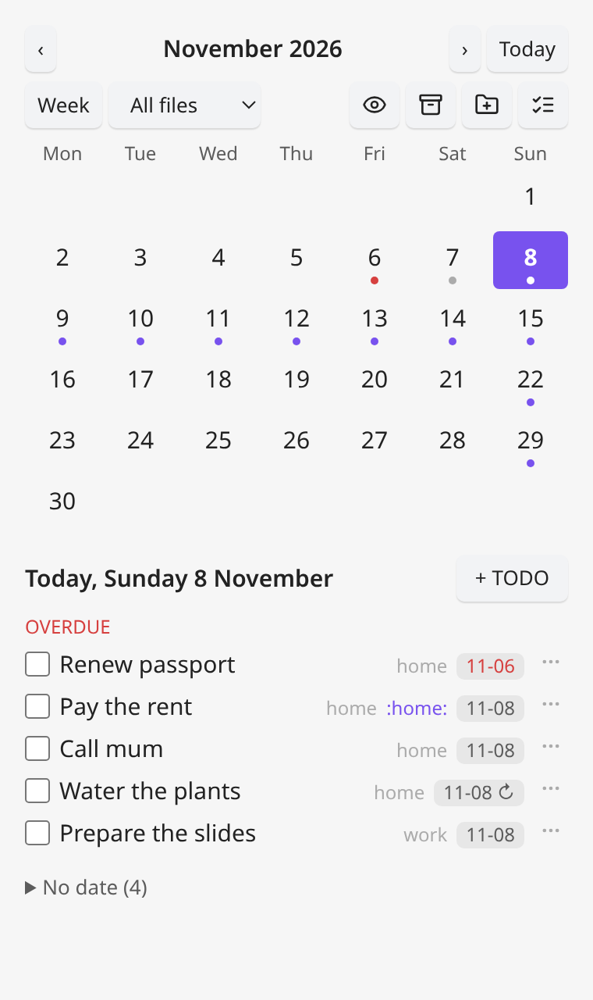

A repeating TODO ("Water the plants", weekly) also shows on its later occurrences, in italics:

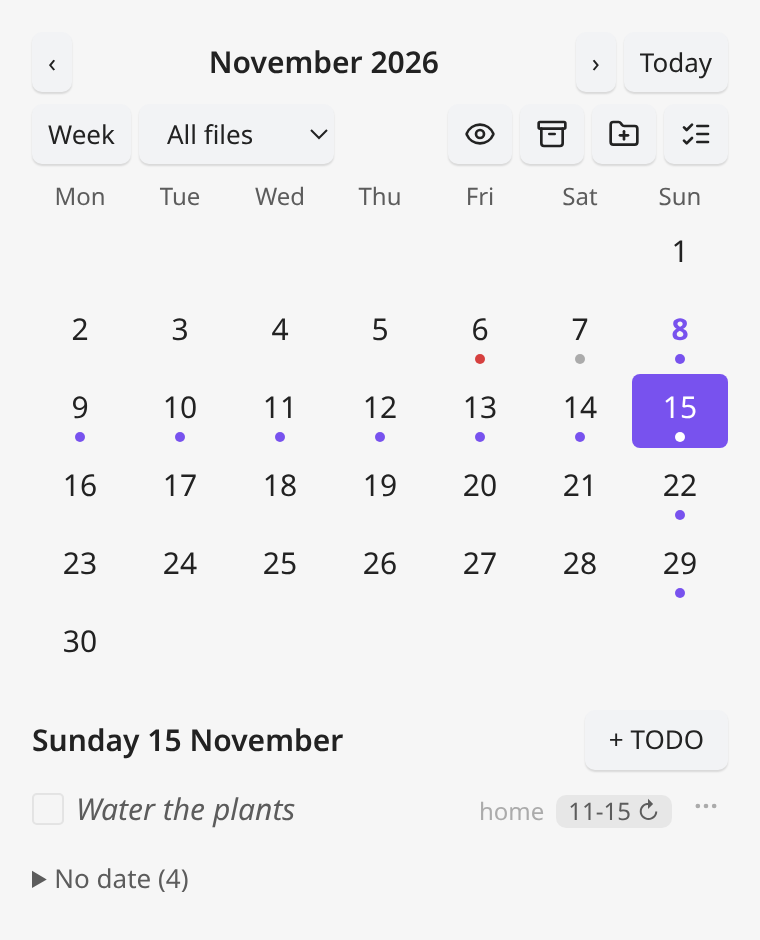

Week view, as seven columns when the pane is wide (stacked in a narrow one):

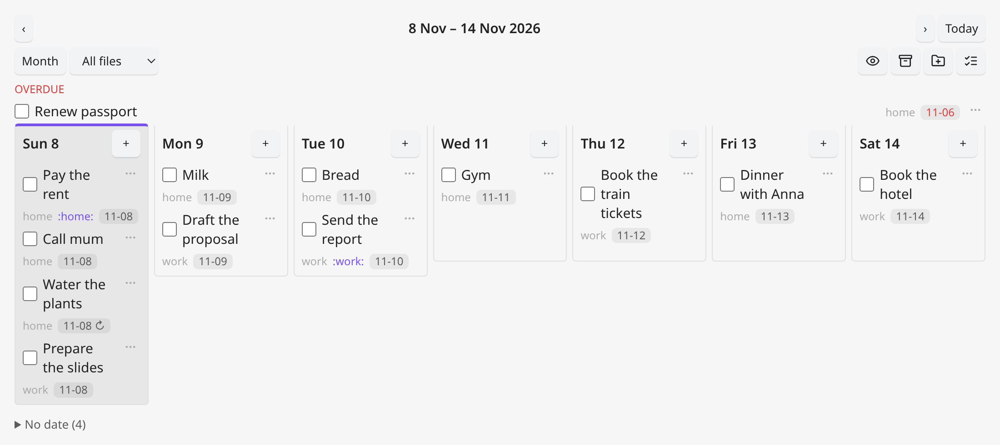

Tasks pane with file chips, lists, sub-items and the *Completed* section (shown here with two files, `home` and `work`):

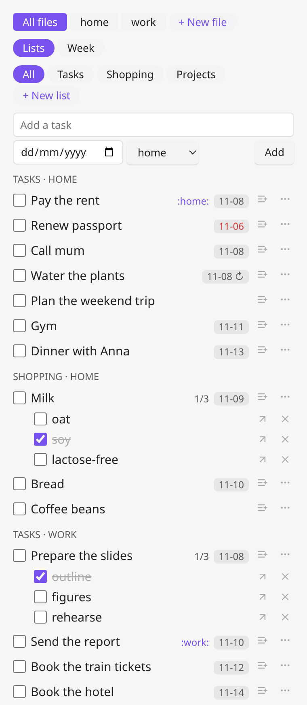

Tasks pane in week mode, grouped by day:

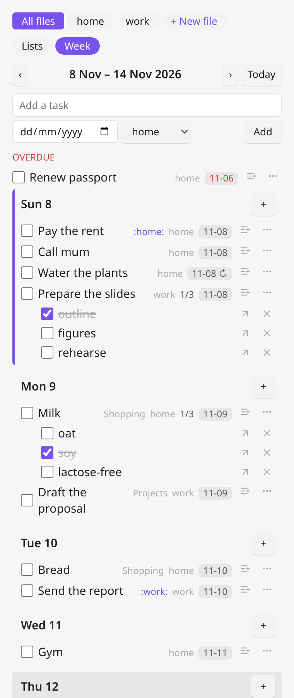

Creating a list or a file, with the same kind of dialog as a new TODO:

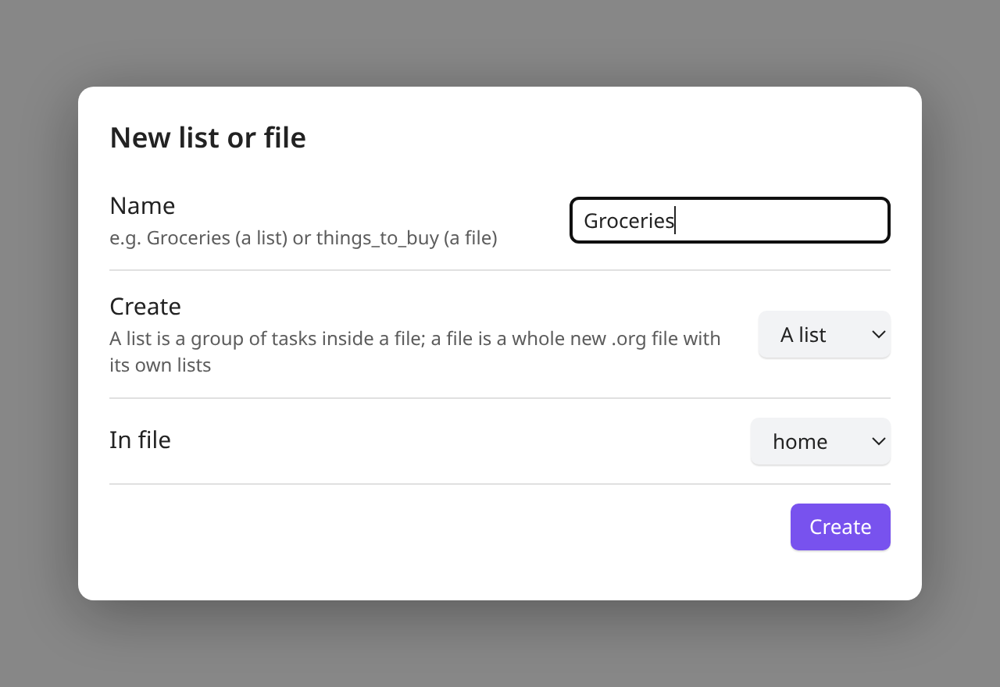

Adding a TODO with a due date:

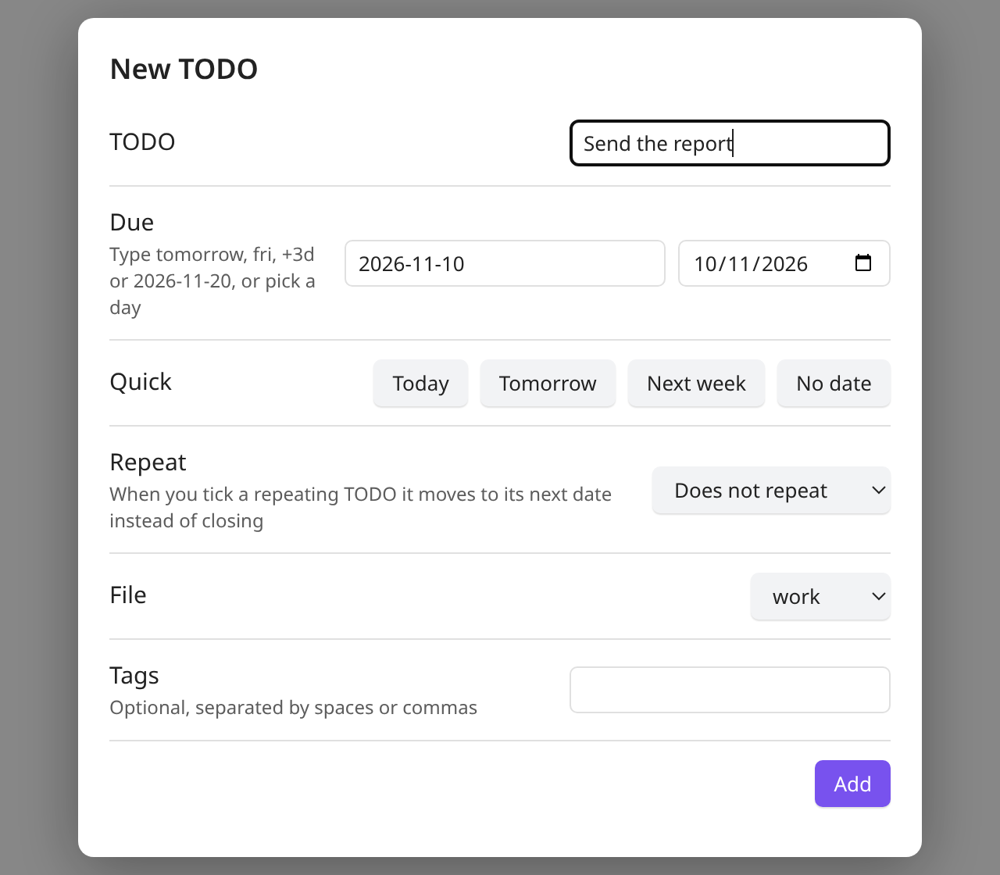

Dark mode, planner and tasks side by side (colours come from your Obsidian theme, so both
light and dark work):

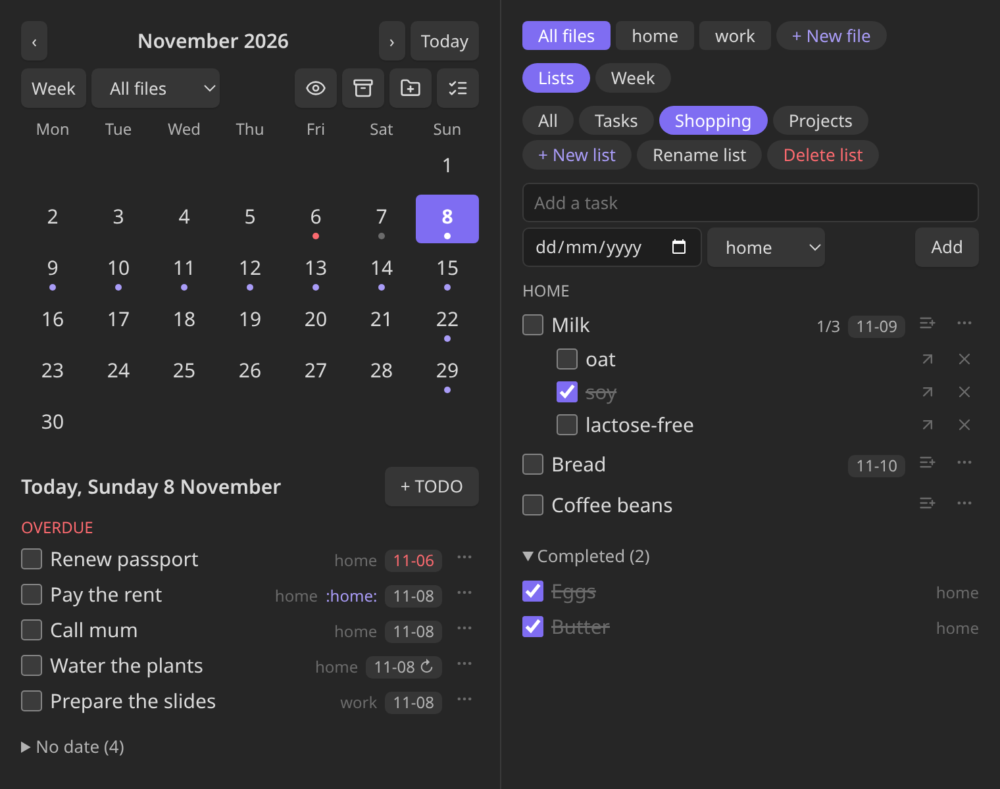

## The TODO files

By default one file, `todo.org` in your vault. You can have as many as you like, for example
`things_to_buy.org` or `work.org`, each with its own lists:

- Click **+ New file** at the top of the Tasks pane (or run the **New TODO file** command) and
  type a name such as `things_to_buy`. The plugin adds `.org`, creates the file (in your first
  task folder if you set one, else next to your first TODO file; type `folder/name` to choose
  another folder, which is created if needed) with a header that makes it open as tasks, adds it
  to your files and switches the panes to it. Typing the name of a file that is already in the
  list just selects it.
- Or put the files in a **task folder** (see [Opening a file as tasks](#opening-a-file-as-tasks)):
  every `.org` file in it is a TODO file, nothing to register.
- Or edit **TODO files** in the settings (one path per line). That is also where you remove a
  file from the list; the file itself is never deleted.

This is what a file looks like:

```org
* TODO Pay the rent                                          :home:
  DEADLINE: <2026-11-10 Tue>
* TODO Call mum
* Shopping
** TODO Milk
   DEADLINE: <2026-11-09 Mon>
   - [ ] oat
   - [X] soy
** DONE Eggs
   CLOSED: [2026-11-07 Sat 18:02]
```

- A **TODO** is a heading starting with `TODO` or `DONE`, with optional `:tags:`.
- Its **due date** is a `DEADLINE:` line right under it. A `SCHEDULED:` date in an existing
  file is read too. When you complete a TODO the plugin adds `CLOSED: [now]`.
- A **list** is a top-level heading without a TODO keyword (`* Shopping`). Its tasks are
  the `** TODO` headings under it. TODOs that are not under a list are in the default
  list, *Tasks*.
- **Sub-items** are Org checkboxes (`- [ ]`, `- [X]`) under a TODO.
- A **repeating** TODO has an Org repeater in its date: `DEADLINE: <2026-11-09 Mon ++1w>`.

### Opening a file as tasks

Besides the panes, a TODO file can open as a **tasks tab**: the same lists, week mode, sub-items and
actions as the Tasks pane, filling a tab, for just that file.

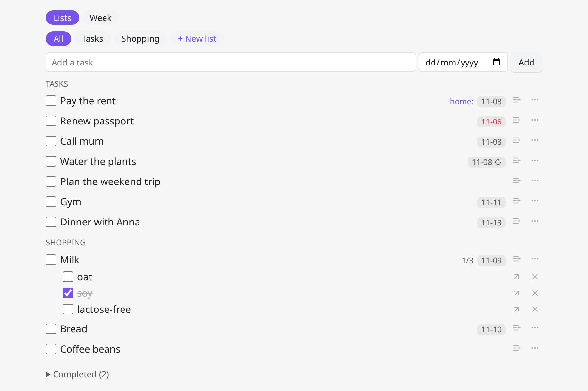

**This is the default for your TODO files**: a file opens as tasks (instead of as text in the Org
editor) when it is

- one of your **TODO files**, listed under *TODO files* in the settings (so `todo.org` opens as
  tasks with no extra setup); or
- in a **task folder**: a vault folder you list under *Task folders* in the settings (for example
  `Tasks`). Every `.org` file in it or below is a TODO file, and anything you drop into the folder
  shows up in the planner and the Tasks pane too. Archive files (`<name>-archive.org`) are skipped;
  or
- any other `.org` file whose **header** has a marker line, `#+PLANNER: tasks`. The header is
  everything before the first heading, so put it next to `#+TITLE:`.

`#+PLANNER: off` in a header keeps a file a normal text file, even if it is one of your TODO files.
Any other `.org` file opens as text as usual.

```org
#+TITLE: Groceries
#+PLANNER: tasks

* TODO Milk
```

- To see the raw file, use **Edit as text** in the tab's header (the tab then stays a text editor
  until you close it). From a text tab, *Open as tasks* in the file explorer's right-click menu, or
  the *Open TODO file as tasks* command, goes back.
- *Make this file open as tasks* (command, on the open `.org` file) adds the marker line for you.
- A marked file that is not in your TODO files shows a notice with an **Add to TODO files** button; its
  tasks are not in the planner until you add it (files in a task folder are always included).
- Files made with **+ New file** also get the marker, so they stay tasks if you later take them out
  of the TODO files.
- The switch happens for tabs that are already open too (when the plugin loads, or when you change
  the TODO files or the setting), not only when you open a file. Your "Edit as text" choice lasts
  until the tab is closed or Obsidian restarts.
- If a file opens as text and you don't know why, run **Why does this file open as text? (diagnose)**:
  it shows whether the file is a TODO file, what its header says, whether the setting is on and
  which view the tab uses.
- Turn the whole behaviour off with **Open TODO files as tasks** in the settings. Opening a file
  from a task's title or *Open in file* always shows the text editor.

### Several files

With more than one file, each is labelled by its name (`home.org` → *home*). The planner and the
Tasks pane show all files together, with the file name next to each TODO, or one file at a time:
use the **All files / home / work** dropdown in the planner, or the file chips at the top of the
Tasks pane (the choice is shared by both panes and is not remembered after a restart). New TODOs
go to the file you are looking at, or you pick one in the *New TODO* dialog and the *Add a task*
row. Lists belong to a file, so `home.org` and `work.org` can each have their own *Shopping*.

**Moving a TODO to another file**: open the TODO's menu (the **⋯** button on its row, or right-click
/ long-press) and choose *Move to another file*, or click the file name shown next to it. The TODO moves with its notes,
sub-items and child headings. A task inside a list goes into the list of the same name in the
other file (created if it is missing); any other TODO goes to the end of the file. In an open
TODO file you can use the *Move TODO under cursor to another file* command. The TODO is written to
the new file before it is removed from the old one, so a failure can't lose it.

You can edit the file by hand at any time; the panes redraw when it is saved.

## Using it

### Planner (calendar)

Open it from the calendar icon in the ribbon (or the *Open planner* command).

- **Month view**: a dot on every day that has TODOs, including future occurrences of repeating ones (red if something there is overdue).
  Click a day to see its TODOs below the calendar. Today's list also shows everything
  that is overdue. TODOs without a date are in a *No date* section.
- **Week view**: the *Week* button switches to the selected day's week, one block per
  day with a **+** to add a TODO for that day. When the pane is at least 640 px wide
  the days become seven columns. *Month* switches back.
- **‹ ›** move by a month or a week, **Today** jumps back.
- Tick the checkbox to complete a TODO, untick it to reopen it. Click a title to jump to it
  in the file. Click a date chip to change the due date.
- The second toolbar row has the *Month* / *Week* switch, the file dropdown (with several
  files) and, on the right, four buttons: the **eye** shows or hides completed TODOs, the
  **archive** button (visible when there are completed TODOs) moves them out of the way
  (see [Archiving](#archiving)), the **folder +** button creates a new list or file
  (see [New list or file](#new-list-or-file)), and the **list** button jumps to the Tasks pane.
- Double-click a day to add a TODO for it (on touch screens use the *+ TODO* button).

### Tasks

Open it from the list icon in the ribbon (or *Open tasks*). It is meant for working
through lists, like Google Tasks:

- With several files, chips at the top pick **All files** or one file; **+ New file** adds another file.
- Tabs for **All**, the default **Tasks** list and each of your lists. The **+ New list** button (or the *New list* command) creates a list such as *Groceries*; with several files it asks which file to create it in.
- **Add a task** at the top (with an optional due date, and the file if there are several). It goes into the selected list.
- Each task has a tick box, its tags and a due-date chip. Sub-items appear under it with
  their own tick boxes and an `n/m` count. The list-plus button on a task adds a sub-item
  (Enter adds it, Escape closes the box).
- **Completed** tasks are folded at the bottom of the list.
- **Drag a task** to reorder it (near the top or bottom edge of another task, or onto a list or, in
  week mode, a day), see [Reordering tasks](#reordering-tasks); **drag it onto the middle of another
  task** (of the same file) to make it a sub-item of that task, **drag a list tab** onto another to
  reorder the lists ([Reordering lists](#reordering-lists)), and
  **drag a sub-item out** onto a list (or, in week mode, a day) to make it a task, see
  [Making a task a sub-item](#making-a-task-a-sub-item) and
  [Making a sub-item a task](#making-a-sub-item-a-task).
- **Week mode**: the *Lists / Week* switch at the top shows the same tasks grouped by day
  instead of by list, for the week of the selected day (‹ › move by a week, *Today* jumps back).
  Overdue tasks come first, then one block per day with a **+** that starts a new task for that
  day (the due date is pre-filled), then a folded *No date* section. Sub-items can be ticked and
  added here too, each task shows its list (and file), and later occurrences of repeating tasks
  are shown read-only like in the planner. The choice is remembered.

### Due dates

Every dialog that asks for a date (New TODO, or the date chip on a task) accepts:

| Type | Meaning |
| :--- | :--- |
| `2026-11-20` | that day |
| `today`, `tomorrow` | |
| `+3d`, `+2w` | in 3 days, in 2 weeks |
| `fri`, `friday` | the next Friday (never today) |
| *(empty)* | no date |

You can also pick the day with the date picker, or use the *Today / Tomorrow / Next week / No date* buttons.

### Repeating TODOs

Choose a **Repeat** interval (every day, week, 2 weeks, month or year) in the *New TODO* dialog
or when you change a due date. A repeating TODO shows a ↻ next to its date. When you tick it
the TODO is not closed: its date moves to the next occurrence, its tick-box sub-items are
cleared and it stays open, so it comes back on that day.

The repeater is the standard Org one, so Emacs understands it too, and you can write
the other kinds by hand: `+1w` moves the date by exactly one interval, `++1w` (what the dialog
uses) keeps moving it until it is in the future, which suits a weekly task you completed
late, and `.+1w` counts from the day you complete it. Month and year steps clamp to the end of
short months (31 January + 1 month = 28 February).

The planner also shows the **future occurrences** of a repeating TODO: in the month and week
views it appears, in italics with a disabled tick box, on each later day that is on screen,
and those days get a dot. They are only a preview: tick the next real occurrence (the first one,
with a normal tick box) to move the TODO on. Hover a projected row to see which date that is. An
overdue repeating TODO is not repeated into the past, and a `.+` repeater, which depends on the
day you complete it, is only approximated. Completed occurrences are not kept as history.

### New list or file

Like *New TODO*, but for a new category: one dialog (the **folder +** icon in the ribbon, the **folder +**
button in the planner toolbar, or the *New list or file* command) asks for a **name** and whether to
create **a list** (a group of tasks inside a file, such as *Groceries*; with several files you also
choose which file) or **a file** (a whole new `.org` file such as `things_to_buy`, with its own lists).
It then shows the result in the Tasks pane. The Tasks pane's **+ New list** and **+ New file** buttons
and the *New list* and *New TODO file* commands do the same one thing each.

### Reordering tasks

Drag a task in the Tasks pane (or the tasks tab of a file) to change its place in the file:

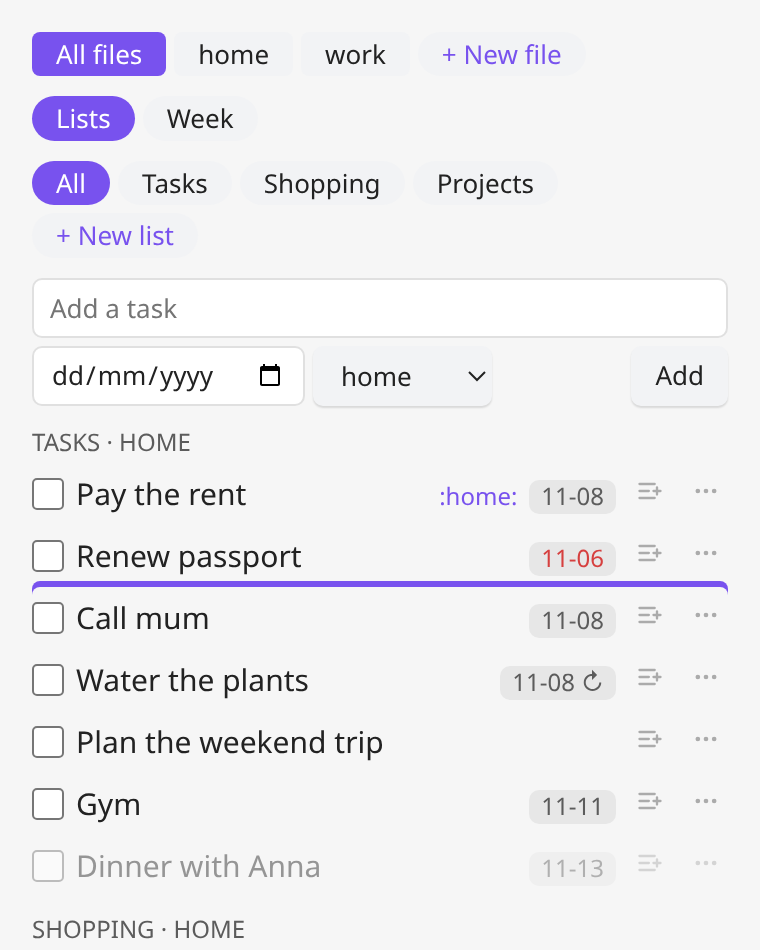

- **Onto another task**, near its **top or bottom edge**: it goes just before or after that task, and
  a line shows where. It takes that task's place in the list, so dragging into another list's tasks
  moves it to that list. (The middle of a task means "make it a sub-item", see below.)
- **Onto a list**: a list tab (*Tasks* for the default list) or the list's section in the pane. It
  moves to the **end of that list**.
- In **week mode**, onto a **day** block: it keeps its place in the file but gets that day as its
  **due date** (a repeat on its date is kept). Week mode has no before/after zones, because the
  file's order isn't visible there.

Everything under the task moves with it (notes, sub-items, sub-TODOs). Only tasks of the same file
can be dropped on each other and on that file's lists; use *Move to another file* to change files.
A task can't be dropped on itself or its own sub-tasks.

Without dragging (touch screens): the task's menu (**⋯**, right-click or long-press) has **Move
up** and **Move down**, which swap it with the previous or next open task of its list.

### Reordering lists

The order of the lists is the order of their headings in the file. To change it, drag a list **tab**
in the Tasks pane onto another list's tab: drop it on the **left half** to put it before that list,
on the **right half** to put it after, and a bar shows where it will go.

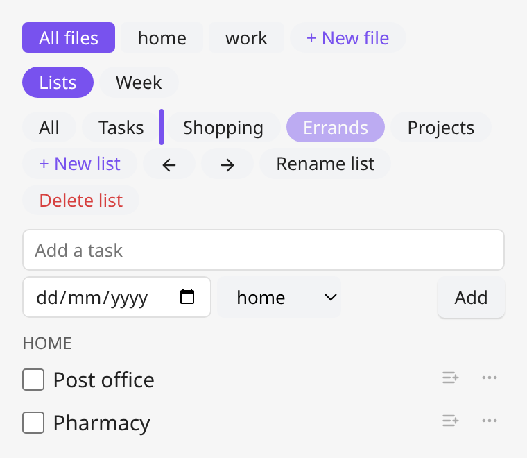

- A list moves with everything under its heading: its tasks, their notes and sub-items, and any other
  text there.
- With several files, dropping on a tab moves the list in **every file that has both lists**; a file
  that lacks one of them is left alone (a notice appears if no file has both). To reorder in one file
  only, select that file's chip first, or drag the list's **section header** (the small heading above
  its tasks in the *All* tab) onto another header of the same file: the top half puts it before, the
  bottom half after.
- *Tasks* (the default list, whose tasks sit outside any list) and *All* are not lists and can't be
  dragged or dropped on. Top-level tasks that sit between lists in the file stay where they are.

Without dragging (touch screens): select the list's tab and use the **←** and **→** buttons next to
*Rename list* to move it one place left or right (a notice says when it is already first or last).

### Making a task a sub-item

Drag a task in the Tasks pane (or the tasks tab of a file) onto the **middle** of another open task of the **same file**:
it becomes a tick-box sub-item of that task (`- [ ] title`, ticked if it was done) and is removed from
where it was. The target is highlighted while you drag over it. Its own notes, tick-box sub-items and
sub-TODOs come along as nested tick boxes under it.

A sub-item is only a tick box, so a **due date, repeat and tags are not kept**. When there is any,
a confirmation says which first; a task without them converts straight away. A task can't be dropped
onto itself or onto one of its own sub-tasks, or onto a task of another file.

Dragging doesn't work on touch screens, so the task's menu (the **⋯** button, right-click or
long-press) also has **Make a sub-item of...**, which asks for the target from the open tasks of
the file. Like deleting, it edits the file directly and can't be undone from the plugin.

### Making a sub-item a task

The reverse also works. Drag a sub-item (a tick box under a task) **out** of its task and drop it on:

- a **list**: a list tab (*Tasks* for the default list), or the list's section in the pane. It becomes
  a task at the end of that list, in the sub-item's own file (sections of another file don't accept it);
- in **week mode**, a **day** block: it becomes a task **due that day**.

Without dragging (touch screens): the **↗** button on the sub-item's row, or right-click /
long-press and **Make it a task**, turns it into a task in the same list as the task it belonged
to. A ticked sub-item becomes a done task. Tick boxes and notes nested under the sub-item (for
example after you made a task a sub-item) come along as the new task's own sub-items and notes.

### Renaming a task or a list

- **Task**: open its menu (the **⋯** button on its row, or right-click / long-press) and choose
  **Rename**, or run *Rename TODO under cursor* in an open TODO file. Only the title changes: its
  state, tags, due date, repeat, notes and sub-items stay as they are.
- **List**: select the list's tab in the Tasks pane and click **Rename list**. Its tasks stay in it
  and the tab stays selected. If the list exists in several files (and *All files* is selected) it
  is renamed in all of them.

A name is refused (with a notice) if it is empty, or for a list if a file already has a list with
that name, or if it starts with `TODO` or `DONE` or ends in `:tags:`, since the file would then read
those lines as a task or as tags. The same rule applies when you create a list.

### Deleting a TODO

Open the TODO's menu with the **⋯** button at the end of its row (or right-click, or long-press on
mobile) and choose **Delete**. After a confirmation the TODO is removed from its file together
with its notes, tick-box sub-items and any child headings; the dialog says how many sub-TODOs
go with it, and that a repeating TODO takes all its future occurrences with it. In an open TODO
file the *Delete TODO under cursor* command does the same. The menu also has *Rename*, *Set due date*,
*Move to another file* (with several files) and *Open in file*.

Deleting changes the file directly, so it can't be undone from the plugin. If the file is open
in Org Reader you can undo it there with `Ctrl+Z`; otherwise restore it from your sync or
backup history. To keep a finished TODO around instead, use [Archiving](#archiving).

### Deleting a sub-item or a list

- **Sub-item**: click the **✕** at the end of its row in the Tasks pane (the **↗** next to it makes
  it a task instead). Only that one tick-box line is removed, with no confirmation.
- **List**: select the list's tab in the Tasks pane and click **Delete list**. After a
  confirmation that says how many tasks go, the list's heading is removed together with
  everything under it: its tasks, their notes and sub-items, and any other text there. If the
  list exists in several files (and *All files* is selected) it is deleted from all of them.
  The default *Tasks* list has no heading, so it can't be deleted; delete its tasks one by one.

Like deleting a task, both edit the file directly and can't be undone from the plugin (use
`Ctrl+Z` if the file is open in Org Reader, or your sync/backup history). Use
[Archiving](#archiving) first if you want to keep the finished tasks of a list.

### Archiving

*Archive completed TODOs* (command, or the archive button in the planner) asks for confirmation
and then moves every DONE TODO, with its notes and sub-items, to the end of the file's
archive, named after it: `todo.org` → `todo-archive.org`, `work/home.org` →
`work/home-archive.org`. With several files it archives the ones you are looking at.
Nothing is deleted: the archive is written first, and a DONE TODO that
still has an open sub-TODO stays where it is.

## Commands

Run from the command palette (`Ctrl+P`, prefix "Org Todo Planner: "). Assign hotkeys in Settings → Hotkeys.

| Command | What it does | Ribbon |
| :--- | :--- | :--- |
| **Open planner** | Calendar pane (month / week) in the right sidebar. | calendar-check |
| **Open tasks** | Lists pane in the right sidebar. | list-checks |
| **New TODO file** | Asks for a name, creates the file (e.g. `things_to_buy.org`), adds it to the TODO files and selects it. | |
| **New list or file** | One dialog to create a list (in a chosen file) or a whole new file. | folder-plus |
| **New list** | Asks for a name (and the file, with several files) and creates the list, then shows it in the Tasks pane. | |
| **New TODO** | Asks for a title, due date, tags and (with several files) the file, and adds it to the end of that file. | plus-circle |
| **Open TODO file as tasks** | Opens a TODO file (asks which one if there are several) as a tasks tab. | |
| **Make this file open as tasks** | Adds `#+PLANNER: tasks` to the header of the open `.org` file and opens it as tasks. | |
| **Why does this file open as text? (diagnose)** | Shows what decides how the active file opens (TODO file or not, header, setting, tab view). | |
| **Open TODO file** | Opens the TODO file in Org Reader (asks which one if there are several). | |
| **Archive completed TODOs** | Moves done TODOs to their file's archive file. | |
| **Toggle TODO under cursor** | In an open TODO file, completes or reopens the TODO at the cursor. | |
| **Rename TODO under cursor** | In an open TODO file, asks for a new title for the TODO at the cursor. | |
| **Delete TODO under cursor** | In an open TODO file, deletes the TODO at the cursor (after a confirmation), with its notes and sub-items. | |
| **Move TODO under cursor to another file** | In an open TODO file, asks for the destination file and moves the TODO there (only with several files). | |
| **Set due date of TODO under cursor** | In an open TODO file, asks for a new due date. | |

## Settings

- **TODO files**: paths inside the vault, one per line (default `todo.org`).
- **Task folders**: optional vault folders, one per line. Every `.org` file in them is a TODO file
  and opens as tasks; new files from **+ New file** go into the first one.
- **Open TODO files as tasks**: on by default; opens your TODO files (and any file with
  `#+PLANNER: tasks`) as tasks instead of text, see [Opening a file as tasks](#opening-a-file-as-tasks).
- **Open panes in**: *Automatic* (main area on mobile, right sidebar on desktop), *Right sidebar* or *Main area*.
- **Default view**: what the planner shows when it opens: *Last used* (default), *Month* or *Week*.
- **Week starts on Monday**: calendar layout (on by default).
- **Show completed TODOs**: also toggled by the eye button.
- **Tags column**: right edge for `:tags:` on new TODOs (default 77, as in Emacs).

## Mobile

It runs on Obsidian mobile and has larger touch targets there. On mobile the planner and
tasks panes open as a normal tab in the main area (not in the swipe-in sidebar); change
this with the **Open panes in** setting.

For one-tap access to the Tasks pane, set it as Obsidian's mobile Quick Action: Settings →
Mobile → *Configure mobile Quick Action* (or the toolbar), then pick the command
**Org Todo Planner: Open tasks**. The ribbon icons are also in the ribbon menu (the button
in the bottom bar). If your vault is synced
(for example with Syncthing), the plugin folder must be a real folder, not a symlink.
Remember to install and enable Org Reader on the phone too.

## Install

- **Community plugins**: Settings → Community plugins → Browse → search "Org Todo Planner".
- **BRAT** (before it is listed, or to try a pre-release): add `ESeNonFossiIo/obsidian-org-todo-planner`.
- **Manually**: copy `main.js`, `manifest.json` and `styles.css` from the latest
  [release](https://github.com/ESeNonFossiIo/obsidian-org-todo-planner/releases) into
  `<vault>/.obsidian/plugins/org-todo-planner/` and enable the plugin in Settings → Community plugins.

The plugin makes no network requests. It reads and writes only the `.org` files you configure (and their
`-archive.org` files), and keeps its settings in `data.json` inside its plugin folder. It never lists your
vault: if you set *Task folders* it looks inside those folders only, and nothing otherwise.

## License

MIT, see [LICENSE](LICENSE).

## Development

Source is in `src/`: `core.js` (pure Org/TODO/date logic, unit-tested), `planner.js`
(calendar pane), `tasks.js` (lists pane), `modals.js`, `settings.js` and `main.js` (the
plugin). `main.js` at the repo root is the esbuild bundle Obsidian loads; it is
generated and gitignored.

```
npm install
npm test         # unit tests for src/core.js
npm run build    # bundle src/ -> main.js
npm run dev      # rebuild on change
```

To try changes in Obsidian, put your vault's plugin folder in a gitignored
`.deploy-target` file (`echo "~/vault/.obsidian/plugins/org-todo-planner" > .deploy-target`);
`npm run build` then copies the three built files there. Obsidian only reloads plugin
code on startup or when the plugin is toggled off and on.

Put logic that doesn't need Obsidian in `src/core.js` and cover it in `test/core.test.js`.

### Releasing

`npm version X.Y.Z` (from an up-to-date `master` with passing tests) updates
`manifest.json` and `versions.json`, tags `X.Y.Z` (no `v` prefix) and pushes; the GitHub
workflow then builds, tests and publishes a release with `main.js`, `manifest.json` and
`styles.css`.
